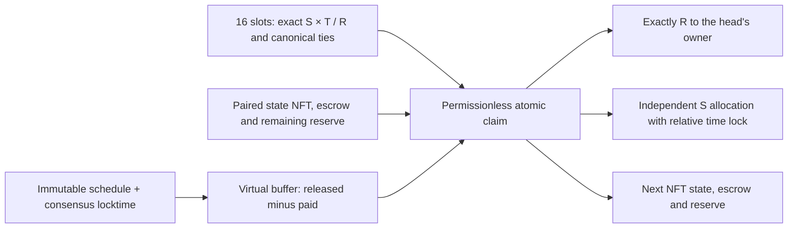

# Staking Arena v3 design

V3 is a separate regtest-only covenant family. V1/v2 scripts, saved configurations,
indexers and wallet journals retain their existing meanings. Existing vaults cannot
be upgraded in place: creators fund a new v3 reserve and stakers explicitly register
new commitments. Existing allocations remain governed by their original covenants.

## State and queue

Reuse the append-only 16-slot, 49-byte record array: compressed owner pubkey, S(4),
T seconds(4), R(4), W(1), wins(1), cancelled(1), refunded(1). Canonical registration
order is the slot index. Slots are never recycled. Cancelled and completed offers
are excluded from ranking, but no active offer is skipped for insufficient rewards.
The state witness is 794 bytes: five zero bytes, count(1), records(784), remaining
reserve(4). The NFT commits to hash256(state). No phase, period or snapshot exists.
Ranking compares S*T*other.R with other.S*other.T*R, breaking ties by earlier slot.

Immutable parameters are the two asset IDs (zero means BCH), epoch (schedule start),
interval seconds, release count (1..16), and release amount (1..1,000,000 raw units;
BCH minimum 1,000 sats). Total reserve = count * amount, funded at genesis. S is
1,000..1,000,000 raw units, W is 1..16, and T is 1..33,553,920 seconds. Ranking uses exact BCH BigInt arithmetic (the maximum cross product exceeds signed
64-bit range); JavaScript comparisons use bigint throughout. Token units have no
inferred decimals. Capacity is sixteen lifetime registrations, including cancelled
and completed offers. All updates serialize through one mutable NFT and its paired
escrow and reserve outputs; contention is resolved by BCH double-spend consensus.

## Transactions and accounting

Genesis consumes the factory at input zero and exact full reward funding. It creates
state NFT, escrow and reserve at outputs 0, 1, 2. Each retains 1,000 BCH sats independently
of the configured assets. No NFT capability is granted to staking or reward assets.
All transitions spend these three canonical sibling outpoints and recreate them.
Genesis and transitions pin transaction version 2 and every input sequence to
0xfffffffe. Allocation withdrawals pin version 2, the exact CSV sequence, and a
0xfffffffe sponsor sequence. This keeps valid covenant spends within the replay
validator's timing model, including authenticated registration/cancellation paths.
Registration also spends exact S*W funding and requires the owner's signature.
Cancellation marks an offer immediately inactive; authenticated refund returns only
S*(W-wins). Independent allocations cannot be touched by cancellation or refunds.
Claim needs no owner signature: covenant compares the selected record against every
active record, pays exactly R to its owner, increments wins, subtracts S from escrow
and R from reserve, and creates a separate allocation at output 4. Last wins remove
an offer from the active queue. No activation or empty-period action exists.
Allocation scripts bind a 110-byte tuple: owner(33), vault category(32), slot(1),
zero-based win ordinal(4), S(4), required CSV sequence(4), staking asset ID(32).
The win ordinal replaces the old allocation metadata's period field; it has no
schedule meaning. Each allocation is independently spendable only by its owner
after relative maturity.

Every transition requires exactly 10,000 BCH sats in fees, externally funded by one
BCH-only sponsor input. Extra token payout/allocation carriers also come from that
input. Protected amounts cannot fund fees. The Claim reward interface now requires
a connected caller wallet to sign that BCH input in the atomic claim transaction.
The caller may differ from the winner and receives no reward or reimbursement.
Optional output 5 returns BCH change to exactly the input 3 locking script.
See [caller-funded claims](staking-arena-v3-caller-fees.md) for the updated format. Broadcasting is pending; only canonical proof verification is
confirmation. Signed operation journals are persisted before broadcast.

## Timing

Let N(t) = clamp(floor((t-epoch)/interval), 0, releaseCount).
Paid = initialReserve - remainingReserve. Virtual buffer = max(0, N(t)*amount-Paid),
capped by remainingReserve. At a claim, the covenant reads transaction locktime and
also executes CLTV (`tx.time >= epoch+interval`) to forbid final sequence bypasses. BCHN
requires timestamp locktime to be strictly below the prior block's median time past
(BIP113). Builders use t = tip MTP - 1. Thus releases become usable when MTP exceeds
the UTC boundary, never earlier; wall clock is informational only. A backdated
locktime only reduces availability. No release transactions or trusted clock needed.

Locktime cannot prove the actual confirmation time. Allocations therefore require
CSV with time flag 0x400000 and ceil(T/512) units. BIP68 measures from the MTP of the
block before the claim's confirmation block. Withdrawal requires transaction version
2 and compatible sequence; BCHN enforces input age. T is independent of the release
schedule, with up to 511 seconds conservative rounding. Script-only VM validation
cannot validate chain age: testmempoolaccept and confirmed replay are also required.

Sources: BCHN consensus implementation https://gitlab.com/bitcoin-cash-node/bitcoin-cash-node/-/blob/master/src/consensus/tx_verify.cpp,
BIP68 https://github.com/bitcoin/bips/blob/master/bip-0068.mediawiki,
BIP113 https://github.com/bitcoin/bips/blob/master/bip-0113.mediawiki.

## Blocking, security and compatibility

Registration checks R <= currently unspent reserve, regardless of released buffer.
A later winner can leave another offer with R > remaining reserve. That offer is permanently unpayable because releases never replenish the remaining
reserve. It remains ranked and blocks claims while it is the head. Its owner can
voluntarily cancel; an affordable new offer can also displace it through ordinary
priority ranking if registration capacity remains. With no such change, especially
a full lifetime roster, the queue can remain blocked indefinitely. Neither clients
nor covenant may skip or automatically delete it. A sufficiently small buffer similarly blocks the top offer
until later releases. Reserve exhaustion does not unlock allocated stakes.

Indexer replays canonical genesis and transitions, verifies scripts and state,
tracks independent allocations and their relative maturity, requires provider
agreement, and blocks action on pending state spends. Reorgs invalidate cached state;
refresh replays the new branch. Unconfirmed records never authorize claims.

Inherited limitations: serialized throughput, sixteen lifetime slots, bounded raw
amounts and release count, single-input fee funding, external BCH liquidity, and possible
permanent head blockage. At most 256 wins can occur across the sixteen lifetime offers with W <= 16.
Exhausted registration capacity can therefore strand an unused reserve even without
head blockage. No creator sweep or parameter mutation is introduced. Lost
owner keys can strand commitments. Browser local configuration is a discovery hint,
not chain authority. Regtest is evidence of behavior, not production readiness or a
security audit. No v3 chipnet/mainnet deployment is authorized.

## Browser use and validation

The new route is `#/v3`. Creation and offer funding use the existing WizardConnect
signing interface and immutable unsigned transaction plans, with a separate v3
IndexedDB journal. Public inspection works without a wallet; new claims require
explicit wallet authorization of the caller BCH input.
Set `VITE_V3_REGTEST_ENDPOINTS` to two local WSS Electrum Cash 1.5 endpoints
(default `wss://127.0.0.1:4177,wss://localhost:4177`). Both must serve the local BCHN
regtest genesis; public endpoints are rejected in regtest mode. Use a local Fulcrum
instance plus a TLS WebSocket bridge. No regtest index server is bundled here.
Two host names pointing to one local node are a development convenience, not two
independent security authorities. Wallet sessions must explicitly declare regtest;
public Cashonize signing on regtest has not been established by these tests.

Electrum verification checks Merkle proofs, linked headers and provider agreement;
it does not independently run full consensus/chainwork validation or prove history
completeness. Peers can misreport liveness or hide spends; BCH consensus still rejects
stale or conflicting transactions and the covenant still fixes the winner. This
inherited browser verification limitation is not a trusted protocol operator.

The UI shows exact integer amounts and priorities, continuous insertion rank,
remaining reserve, virtual buffer, next UTC release, head blockage reasons, independent
allocation maturity, a pending-display toggle, and saved operation recovery. Verified
snapshots expire after 30 seconds. Clicking claim always verifies again. The caller
pays the fixed miner fee and token carriers directly, with BCH change returned in
the same transaction. FeeSponsorV3 is retained for historical tests/journals; no
pre-funding transaction or donation address is required by the new claim interface.
The winner and payout are covenant-enforced.

Run `npm run node:start`, then `npm run test:v3`. Run `npm test` for existing v1/v2
regressions and the v3 suite (the chipnet-named tests use local fixtures/mocked RPC).
`npm run frontend:test` and `npm run frontend:build` validate the UI. BCHN integration
uses actual regtest broadcasts, MTP, relative sequence locks, conflicts and invalidate/
reconsider-block operations. Portable replay tests additionally exercise provider
outages/disagreement and the maximum 16-record queue with large BigInt ranking
operands. Tests advance local mocktime; use a separate disposable data directory
if the existing local chain must retain its clock.

Source fields `periodSeconds`, `periods`, `cap` are retained as serialized parameter
names for reuse of the current constructor machinery: in v3 these mean release
interval, release count and release amount only. `epoch` is the UTC schedule start, so the Nth release is at epoch+N*interval.
There is no release at epoch itself: three complete hourly intervals release
3,000 of a 10,000-token reserve when the release amount is 1,000. They never define offer
eligibility, T, W, snapshots, activation, ranking or settlement.

Unresolved deployment questions: independent security review; public wallet regtest
support; fee-rate economics beyond the inherited fixed fee; capacity/throughput beyond
16 lifetime registrations; and whether a future version should permit owner-authorized
expiry or other head-blockage remedies. No such remedy or trusted operator is added
here. CSV uses the previous block's MTP rather than wall time, so actual elapsed
wall-clock locking can vary. These are documented protocol semantics, not a promise
of exact wall-clock maturity.

Frontend regression notes: the untouched baseline reproduced two failing assertions:
one expected funding to remain enabled after asset changes cleared acknowledgement,
and another used a single-element query for duplicated saved/current v2 terms. The
assertions now check the disabled acknowledgement gate and the verified terms panel.
The new v3 navigation also updates the expected navigation count. V1/v2 product
behavior is unchanged. Clock-sensitive legacy allocation, deadline, policy and registry regressions now
use disposable regtest nodes so advanced MTP and wallet relay timers cannot
contaminate real-clock assertions or later runs. Assertions and covenant behavior
are preserved.
